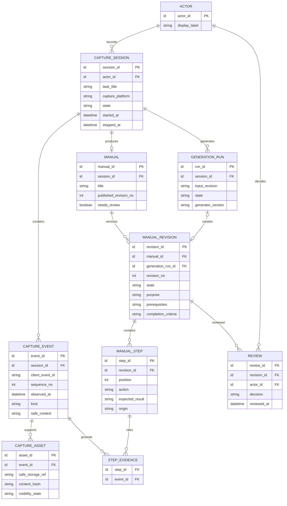

# 데이터베이스 설계 — 개념 ERD 초안

작성일: 2026-10-16. **제안 모델**이며 DBMS·물리 schema·migration·인증 구조는 미정이다. 사용자 확인 범위는 ‘PC 화면과 여러 앱의 업무 흐름을 자동 수집해 인수인계 매뉴얼 작성’이다.

[제품 기획서](기획/01_제품_기획서.md)와 [PoC 계획](기획/02_PoC_검증_계획.md)의 세션·수집 근거·사람 검수 흐름을 모델링한다. 첫 OS는 Windows이며 구체적인 수집 payload는 PoC 후 확정한다.

## 개념 ERD

## 엔티티 책임

| 개체 | 책임·설계 주의 |
|---|---|
| Actor | 수행자/검토자의 논리 식별. 회사 계정·로그인·조직 권한은 미정 |
| CaptureSession | 업무 기록 단위. 목적·OS·허용 범위·정지 구간·수집 설정/동의 버전을 보존하는 제안 |
| CaptureEvent | 앱/창 전환·지원 동작·기록 공백·주석. 입력 값과 창 제목 원문을 무제한 저장하지 않음 |
| CaptureAsset | 제외/마스크 후 화면 근거 참조. 바이너리를 DB 본문에 저장한다고 가정하지 않음 |
| GenerationRun | 고정한 입력과 생성 시도·실패·시간/비용 추적. 실패 시도도 기록 |
| Manual | 한 세션에서 만드는 문서 단위. 여러 세션 병합은 PoC 범위 밖 제안 |
| ManualRevision | 생성/사람 수정의 버전. 게시본을 덮어쓰지 않음 |
| ManualStep | 절차·예상 결과·출처. 관찰/작성자 보완/미확인을 구분 |
| StepEvidence | 단계와 이벤트의 다대다 근거 연결. 화면은 해당 이벤트의 허용된 asset으로 접근 |
| Review | 특정 버전의 사람 승인/반려. 생성 성공과 게시를 구분 |

## 일관성과 상태 제안

- 동일 세션에서 client_event_id와 sequence_no는 각각 중복되지 않게 한다. 이벤트 재전송은 중복 저장하지 않는다. 시각만으로 순서를 복원하지 않으며 유실은 gap 이벤트로 구분한다.
- CaptureSession은 prepared/recording/paused/stopped/cancelled를 구분한다. 정지 구간과 허용 대상은 수집 정책으로 검증한다. PC 수집 권한이 없는 경우 세션을 정상 기록 완료로 표시하지 않는다.
- GenerationRun은 pending/running/succeeded/failed를 구분한다. 생성 입력에는 제외되지 않은 이벤트/근거와 해당 입력 버전을 고정한다. 수집 종료와 초안 생성 성공은 다른 상태다.
- 자동 관찰에서 만든 단계는 같은 세션의 이벤트 근거를 가진다. 작성자가 보완한 단계는 origin=author로 구분하고 관찰 근거가 없다고 사실을 만들어 붙이지 않는다.
- ManualRevision은 draft/in_review/approved/rejected를 구분한다. published_revision_no가 있으면 같은 Manual의 approved 버전이어야 한다. 제목·순서·내용 수정은 새 revision으로 보존하는 방식을 제안한다.
- 검수 후 캡처 근거를 제외/삭제하면 영향받는 게시본을 재검토 대상으로 전환한다. 근거 링크만 남아 원본 화면에 접근되는 일이 없도록 열람/검색/생성 입력을 함께 처리한다.

논리 제약 제안: Manual.session_id는 유일, ManualRevision은 (manual_id, revision_no), ManualStep은 (revision_id, position), StepEvidence는 (step_id, event_id)를 유일하게 한다. StepEvidence의 이벤트는 해당 Manual의 같은 세션이어야 한다. 사람 수정 revision은 generation_run_id가 없을 수 있어 생성 시도와의 연결을 선택 관계로 그렸다. 구체적인 FK·인덱스·컬럼 타입은 물리 설계에서 확정한다.

## 수집 데이터 경계·보관

그림의 CaptureAsset은 외부 보관 가능한 제외/마스크 후 근거다. 마스크 전 화면을 서버로 먼저 보내고 나중에 가리는 구조로 확정하지 않는다. 로컬 원본의 임시 보관·삭제, 제외 데이터의 파생본 삭제, 백업/로그/캐시 범위는 실제 수집 전에 정한다.

PoC에서는 한 업무 세션과 작성자/검토자/인수인계 참여자의 접근 경계를 먼저 검증한다. 기업 멀티테넌시·공유 토큰·벡터 DB·장기 영상 보관·정책 엔진을 이 ERD의 확정 범위로 추가하지 않는다. 운영 제품의 인증·저장 암호화·수명 정책은 별도 상세 설계가 필요하다.

## 물리 설계 전 미결정

Windows 버전/장비, 이벤트 타입·빈도, 이미지/영상/접근성 정보의 조합, 데이터 크기, 근거 보관 기간, 실제 로그인/권한, DBMS·저장소, 동기화/중복 프로토콜, generation 입력 버전 형식, 삭제 시 문서 보존 정책. PoC 결과로 최소 구조를 선택한 뒤 컬럼 타입·FK/UNIQUE/CHECK·인덱스·migration을 작성한다.

[프로젝트 가이드 목록](README.md) · [문서 작성 규칙](00_문서_가이드.md)

## Windows S-01과 모델 연결

[대표 업무](기획/03_Windows_대표업무_시나리오.md)의 한 수행을 CaptureSession 하나로, 브라우저·Excel·편집기 전환과 지원 행동/화면을 CaptureEvent/CaptureAsset으로 연결한다. 수집기 버전·지원 동작과 실제 앱 정보는 허용·정제된 메타데이터로 관리하는 제안이다.

GenerationRun 입력에는 해당 실행의 허용 근거와 작성자 주석만 포함한다. 정답 집계·정답 보고서는 평가자 자료이며 자동으로 CaptureAsset이나 생성 입력에 넣지 않는다. StepEvidence로 조건 확인·자료 가져오기·필터·집계·문서 저장 근거를 연결하되, 화면만으로 수식·숨겨진 셀·저장 성공을 단정하지 않는다. 평가를 위해 확인하는 결과 파일과 제품의 기본 수집 payload는 구분한다.

S-01의 구매 요청 표를 제품 DB의 구매 테이블로 만들지 않는다. 그것은 실험 소재이며 제품의 영구 업무 데이터 모델이 아니다.

## 첫 PoC 저장 구현 제안

개념 ERD는 제품의 관계를 정리한 것이며 첫 PoC에서 SQL 테이블 전부를 구현하지 않는다. [로컬 수집 설계](superpowers/specs/2026-10-16-windows-local-poc-design.md)는 안전한 이벤트 JSONL·session/revision JSON·승인 PNG 파일을 제안한다. Raw 화면은 메모리 후보와 승인 asset 타입을 분리한다. 제외/manifest/버전 일관성은 Core에서 검증하고 DBMS·migration은 PoC 이후 결정한다.
