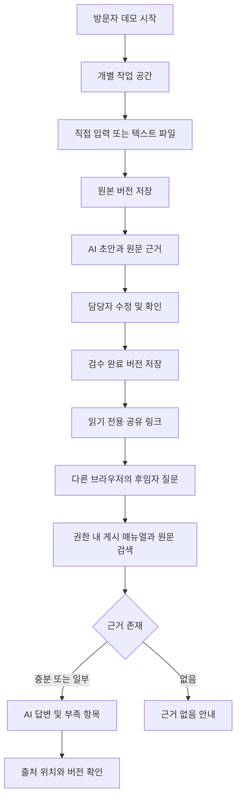

# 업무 플로우

## 이 문서로 작업하기

문서 운영 기준: 2026-10-16. 기술 내용의 확인 시점은 각 절에 따로 표시한다.

| 항목 | 규칙 |
|---|---|
| 담당 범위 | 업무의 시작·상태 전이·실패·복구·역할 전환 |
| 시작 조건 | 자료→검수→질문·공유·수정·삭제의 순서가 바뀔 때 |
| 먼저 확인 | [generation](../src/lib/generation.ts), [manuals](../src/lib/manuals.ts), [공유](../src/lib/shares.ts), [E2E](../tests/e2e/) |
| 남길 결과 | 정상/대체 흐름, 단계별 역할과 상태, 실패 후 다음 행동, 재시도·취소·동시 수정 |
| 함께 갱신 | [02 기능](02_기능_설계.md) · [03 DB](03_데이터베이스_설계.md) · [04 API](04_API_명세.md) · [06 화면](06_프런트엔드_구조.md) |

### 작업 체크리스트

- [ ] [99 작업](99_해야할일.md)에 작업 ID·주관 문서·완료 조건을 정하고 기존 완료 증거를 확인한다.
- [ ] 아래 기술 본문의 현재 구현과 최초 설계 이력을 구분한 뒤 변경 영향을 기록한다.
- [ ] Owner/Reader를 별도 세션으로 실행하고 원본 갱신·재검수·공유 취소·삭제 후 접근까지 증거를 남긴다.
- [ ] [10 점검](10_파일_점검_현황.md)·[진행 기록](구현_진행_기록.md)에 근거를 남기고 99의 상태·다음 행동을 갱신한다.

체크박스는 매 작업에 복사해 사용하는 절차이며 이 문서 자체의 미완료 표시가 아니다. Superpowers 단계와 검증 명령 선택은 [00 문서 가이드](00_문서_가이드.md)를 따른다.

## 2026-10-05 구현 상태
현재 src/app·components·lib, SQL migration, Vitest·Playwright, Docker·CI 설정이 존재한다. 아래 2026-10-03 최초 조사·제안은 설계 이력이며 현재 미구현 상태를 뜻하지 않는다. 최신 실행 결과는 [구현 진행 기록](구현_진행_기록.md), 남은 조건은 [TODO](99_해야할일.md)를 따른다. 실 AI와 공개 배포는 미검증이다.

## 최초 조사 및 설계 이력
변경일: 2026-10-03
현재 실행되는 제품 흐름은 없다. 아래 Mermaid와 시나리오는 제안 흐름이다.

## 정상 흐름

## 실패·빈 상태
| 발생 지점 | 동작·사용자의 다음 행동 |
|---|---|
| 자료 없음 | 자료 추가 또는 합성 예시 선택 |
| 생성 실패 | 원본·입력 유지, 오류 종류 표시, 재시도·원문 확인 |
| 초안만 있음 | 검수 완료 후 질문 가능 안내 |
| 질문 근거 없음 | 해당 절차 미등록 표시, 자료 보완 안내 |
| 일부 근거 | 답할 수 있는 부분과 확인 필요 부분 분리 |
| AI timeout/거절/출력 검증 실패 | AI 답변 대신 검색 원문 표시, 실 AI 실패로 표시 |
| 세션 만료 | 새 데모 시작 안내, 다른 workspace로 자동 연결 금지 |
| DB 실패 | 저장/삭제 성공 표시 금지, 입력 유지와 재시도 |
| Cloudflare/서버 실패 | 외부 가용성 점검 후 복구. 앱이 내려간 경우 UI fallback을 보장할 수 없음 |
| 호출 제한 | 남은 제한과 재개 시간, 검색·원문은 계속 허용 |
| 취소/만료 공유 | 링크 이용 불가 표시, 자료나 제목 유출 금지 |

## 변경과 재검수
원본 수정 → 새 SourceRevision → needsReview=true → 기존 게시본 신규 검색 제외 → 초안 재생성/수정 → 사람 검수 → 새 ManualVersion → 최신 자료로 질문.
AI 생성·질문 도중 원본이나 게시 버전이 바뀌면 저장 직전 검사에서 409로 거부한다. 과거 답변은 당시 버전으로 보되 오래됨을 표시한다.

## 공유와 삭제
Owner의 공유 생성 → 토큰 소지자가 독자 쿠키 교환 → 해당 매뉴얼만 조회·질문. 수정·다른 원문 조회는 거부한다.
공유 취소는 이미 쿠키를 받은 독자에게도 적용한다. 원본 삭제는 연결 매뉴얼과 해당 근거를 쓴 답변 전체를 제거한다.
7일 workspace 만료 즉시 요청 차단 → 하루 1회 정리로 본문 삭제. 이 정책은 제안이며 현재 동작하는 스케줄러는 없다.

## 시연 확인
[상세 설계 11~12절](superpowers/specs/2026-10-03-ghostmanual-mvp-design.md)의 합성 계정 발급 사례를 사용한다.
Owner와 Reader를 서로 다른 브라우저 세션으로 검증한다. 동일 화면에서 역할 이름만 바꾸는 데모로 권한 분리를 입증하지 않는다.

