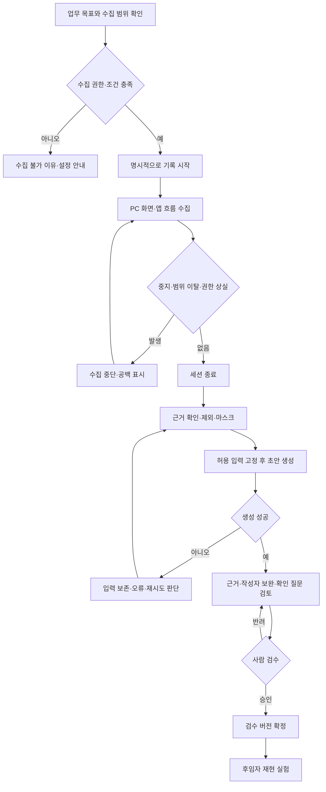

# 업무 플로우 — PC 수집 PoC 초안

상태: 제안, 미실행. Windows·웹 자료 조회→Excel 정리→결과 문서 작성으로 구체화했다. 수집 가능한 행동은 실제 장비에서 검증한다.

반려 후 수정은 새 문서 버전으로 보존하는 제안이다. 업무 수행자가 화면 밖에서 한 판단은 확인 질문으로 남긴다. 창 전환·잠금·기록 중단으로 보지 못한 구간을 AI가 관찰 사실로 보완하지 않는다.

## 변경과 삭제

생성 중 근거가 제외되면 고정 입력의 유효성을 재확인하고 해당 결과의 승인을 막는다. 검수 후 근거 삭제는 영향 버전을 재검토 상태로 바꾸고 근거 열람·생성 입력·내보내기에서 접근이 남지 않는지 확인한다. 실제 데이터 폐기/이력 보존 정책은 실험 전에 결정한다.

[기획서](기획/01_제품_기획서.md) · [ERD](03_데이터베이스_설계.md) · [PoC](기획/02_PoC_검증_계획.md)

## S-01 단계 연결

기록 시작 → 합성 웹 페이지 조회·CSV 받기 → Excel 가져오기 → 기간/승인 필터 → 부서별 건수·금액 집계 → 결과 문서 작성·저장 → 기록 종료 → 근거 확인 → 초안·검수 → 다른 사람의 재현 실험.
정답·자료·관찰할 근거는 [S-01](기획/03_Windows_대표업무_시나리오.md)에서 관리하며 구현 결과가 아니다.
