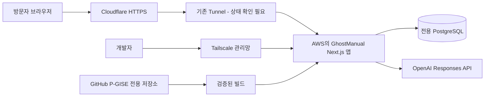

# GhostManual MVP 상세 설계
작성일: 2026-10-03
상태: 사용자의 2026-10-03 가이드 업데이트·계속 진행 요청으로 상세 설계 승인 반영. 제품 구현·배포·실행 검증은 아직 하지 않았다.
승인 범위: 공개 웹 서비스, 보유 AWS·Cloudflare·Tailscale·GitHub 활용 방향.
구현 계획은 docs/superpowers/plans/2026-10-03-ghostmanual-mvp.md에 작성했다. 계획의 사용자 검토와 실행 방식 확인은 다음 단계다.

## 1. 목적과 근거
[제품 정의](../../requirements/제품_정의_프롬프트.md)를 제품 요구사항의 기준으로, [개발 원칙](../../requirements/개발_마스터_프롬프트.md)을 진행·검증 절차의 기준으로 사용한다.
개인의 업무 경험을 구조화하고 사람이 검수한 매뉴얼로 남긴다. 후임자는 매뉴얼과 원본 자료에서 근거를 확인하며 업무 방법을 찾는다.
성공 조건은 한 업무 사례에서 자료 등록부터 다른 브라우저의 후임자 질문 및 출처 확인까지 실제로 연결되는 것이다.
현재 존재하는 파일은 문서뿐이다. 이 문서의 화면·테이블·API·환경변수는 모두 제안이다.

## 2. MVP 범위와 의도적인 제한
- 한국어 UI, 데스크톱·모바일 브라우저, 공개 주소 ghostmanual.pigs0516.com.
- 직접 텍스트 입력, UTF-8 TXT/Markdown 파일 1개 입력. Markdown도 실행하지 않고 일반 텍스트로 취급한다.
- 한 자료로 한 매뉴얼을 만들고, 매뉴얼 여러 개에서 질문할 수 있다. 복수 원본 결합은 후순위다.
- 구조화된 초안, 항목별 원문 근거, 담당자의 수정·검수 완료 저장.
- 원본 수정 시 재검토 처리, 이전 매뉴얼 버전과 과거 답변 근거 보존.
- 방문자별 데모 작업 공간, 검수된 매뉴얼의 읽기·질문 전용 공유 링크.
- 질문별 근거 검색, 근거 기반 답변, 근거 부족과 AI 장애 구분.
- 합성 시연 자료, 이용약관·개인정보 안내 초안, 내 데모 데이터 삭제.
- 초기 미지원: PDF/Word/Excel/OCR, 음성, 기업 계정·다중 조직 관리, 결제, 외부 문서 연동, 별도 벡터 DB, 다중 에이전트, 실시간 공동 편집.
- 실제 기업 기밀과 개인정보를 보관하는 운영 서비스는 이번 공개 데모 범위 밖이다. 입력 전 이 제한을 표시한다.
- 사용자 요구의 Knowledge Owner와 Consumer는 서비스 역할이다. MVP의 실제 검증은 소유자 브라우저와 공유 링크를 연 별도 브라우저로 수행한다.

## 3. 접근 방법과 기술 결정
| 접근 | 장점 | 비용·제약 | 결정 |
|---|---|---|---|
| Next.js 단일 앱 + PostgreSQL + 단일 AI 제공자 | 화면·API를 같은 코드로 관리하고 SQL로 버전·소유권 일관성 유지 | 서버와 DB 운영 필요 | 권장 |
| React 프런트 + 별도 Python API | 문서 처리 확장에 유리 | 배포·인증·타입 계약이 두 서비스로 나뉨 | 초기에는 보류 |
| Cloudflare Workers 중심 | 호스팅 운영 부담 감소 가능 | 보유 AWS 구조와 별개 설계, 런타임·DB 결합 검토 필요 | 초기에는 보류 |

제안 스택: TypeScript, Next.js App Router, React, CSS Modules, PostgreSQL, pg, Zod, OpenAI 공식 Node SDK, Vitest, Playwright, Docker Compose.
Next.js는 화면과 서버 API를 하나로 묶기 위해 사용한다. pg는 매개변수 SQL과 트랜잭션에 사용하고 초기 ORM은 도입하지 않는다. Zod는 사용자 입력·AI 출력 경계 검증에 사용한다. CSS Modules와 CSS 변수로 UI를 구성하고 아이콘·컴포넌트 대형 라이브러리는 기본 설치하지 않는다.
정확한 패치 버전은 구현 계획 작성 시 호환성과 보안 공지를 확인해 lock file로 고정한다. 현재 설치됐다고 간주하지 않는다.
확인한 로컬 런타임은 Node 24.20.0, npm 11.19.0이다. Docker 실행 파일은 있으나 엔진 실행 여부는 미확인이다. 기본 python 명령은 실행되지 않았다. 이 설계는 Python에 의존하지 않는다.

## 4. 배포 아키텍처

기존 AWS 서버에 별도 Compose 프로젝트 ghostmanual, 전용 DB·볼륨·앱 포트로 배치한다. 제안 앱 바인딩은 127.0.0.1:3200이다. 2026-10-03 실제 조사에서3100은 EventOps가 사용 중으로 확인했다. DB에는 호스트 공개 포트가 없다.
Cloudflare 터널의 ghostmanual 호스트만 앱으로 연결한다. 루트 도메인과 기존 서비스는 별도 경로다.
Tailscale은 운영 접속용이다. 심사위원에게 Tailscale 가입이나 설치를 요구하지 않는다.
SSH 읽기 전용 조사에 성공했다. 서버 메모리1906MB/가용805MB·디스크여유13GB·Docker29.5.3을 확인했다. 새 앱의 부하 적합성과 실제 터널 origin은 미확인이다. 부족하면 신규 서버안을 비용과 함께 다시 결정한다.
GitHub 저장소 제안은 P-GISE/ghostmanual, 초기 private이다. 아직 저장소·DNS·배포를 생성하지 않았다.

## 5. 화면과 사용자 동선
| 화면 | 주된 정보와 행동 |
|---|---|
| / | 데모 안내와 작업 공간 시작. 기존 세션이면 매뉴얼 목록으로 이동 |
| /manuals | 매뉴얼 목록, 초안/검수 완료/재검토 필요, 자료 추가와 질문 진입 |
| /sources/new | 업무 설명 입력 또는 TXT/Markdown, 입력 제한 및 외부 AI 전송 안내 |
| /sources/[id] | 원문과 버전, 수정 및 재생성 |
| /manuals/[id] | 구조화된 매뉴얼, 원본 근거, 버전, 편집·검수 완료·공유 |
| /manuals/[id]/edit | 항목별 편집, 확인 필요 필드, 근거와 원문 비교 |
| /ask | 질문, 관련 매뉴얼, 답변의 문장·단계별 근거 |
| /share | URL fragment의 공유 토큰으로 시작. 검수된 해당 매뉴얼만 읽고 질문 |
| /terms, /privacy | 실제 데모 처리 방식과 운영 정보, 법률 검토 전 초안 표시 |

주요 레이아웃: 작은 내비게이션 + 넓은 업무 내용 영역. 상세 화면은 본문과 근거 패널로 구성한다. 모바일에서는 근거를 본문 아래 펼침 영역으로 배치한다.
오프화이트 바탕, 짙은 본문, 한 가지 강조색, 상태별 텍스트 라벨을 사용한다. 장식 gradient·shadow·emoji 아이콘·마케팅 카드·pricing은 사용하지 않는다.
텍스트 버튼, 연결된 label, 키보드 접근, 보이는 focus, 상태 알림 live region을 제공한다. 로딩 퍼센트는 만들지 않고 실제 요청 단계와 실패·재시도만 표시한다.
입력 도중 화면 이동 시 미저장 경고, 요청 실패 시 입력 유지. 빈 목록에는 '자료 추가'와 '합성 예시 불러오기'를 제공한다.
이용약관 및 개인정보 화면의 운영자 연락처는 공개 전 사용자가 확정해야 한다. 확정 전 법률 준수를 보장하는 표현을 쓰지 않는다.

## 6. 입력과 매뉴얼 구조
입력 제한: 제목 1~120자, 본문 100~20,000자, 파일 최대 256 KiB, UTF-8 텍스트만 허용한다. 서버에서도 크기·디코딩·확장자·빈 내용·NUL 바이트를 검사한다. 서버가 검증한 추출 텍스트와 파일명을 저장하며 원본 바이너리는 저장하지 않는다. 이 보관 방식을 입력 화면에 설명한다.
업무명, 목적, 시작 조건, 주기, 담당 역할, 필요 자료·시스템, 순서, 주의사항, 예외와 대응, 완료 조건을 매뉴얼 필드로 사용한다.
정보가 없는 필드는 값 null 또는 빈 배열과 확인 질문으로 표시한다. AI가 추정한 승인자·일정·시스템 메뉴를 채우지 못하게 한다.
각 원문 문단에 버전과 문단 번호를 붙인다. 생성 항목에는 해당 sourceRevisionId, paragraphId, quote를 연결하며 quote가 그 문단에 실제로 존재하는지 검사한다.
수정으로 추가한 경험은 '담당자 입력'으로 표시하고 검수된 Manual 자체를 근거로 삼는다. 원본에 없는 내용을 원본 인용처럼 표시하지 않는다. 소유자 세션의 검수 기록은 신원 인증된 회사 승인과 다르다.

## 7. 자료·매뉴얼·답변의 수명
- Source는 현재 revision 번호를 가진다. SourceRevision은 변경 불가한 텍스트 스냅샷이다.
- Manual은 편집 중 draft와 publishedVersionId를 가진다. ManualVersion은 검수 완료 시 생성하는 변경 불가한 스냅샷이다.
- 최초 초안은 검색 대상이 아니다. 검수 완료 저장 후 게시 버전을 검색할 수 있다.
- 검수 완료는 제목·목적·1개 이상 절차·완료 조건 및 '확인 필요' 필드 처리 여부를 검증한다. 모르는 선택 필드는 '미확인 유지'를 명시적으로 선택할 수 있다.
- draft 수정 중에는 기존 게시 버전을 유지한다. 원본이 수정되면 해당 매뉴얼에 needsReview=true를 즉시 설정하여 이전 게시 버전을 신규 답변 검색에서 제외한다.
- 재검수 후 새 ManualVersion을 게시하면 needsReview=false로 바꾼다. 원본의 현재 revision과 일치해야 게시할 수 있다.
- 생성 시작 시 원본 revision을 고정하고, 생성 완료 시 현재 revision과 다르면 409로 저장을 막는다. 늦은 AI 결과가 새 자료를 덮어쓰지 않는다.
- 질문 생성도 사용한 게시 버전과 needsReview를 응답 저장 직전에 다시 확인한다. 도중 변경되면 409로 재질문을 안내한다.
- 이전 답변은 당시 버전의 근거를 유지한다. 현재 기준으로 오래된 답변인지 표시한다.
- 원본 수정, 검수 완료, 삭제는 트랜잭션으로 처리하고 expectedRevision으로 낙관적 동시성 검사를 한다.

## 8. 근거 검색과 답변
벡터 DB 없이 시작한다. 한국어 NFKC 정규화, 공백·문장부호 정리, 제한된 동의어 사전과 문서 제목·섹션·본문의 키워드 일치를 사용한다. PostgreSQL pg_trgm 후보 검색을 병용한다. 형태소 분석이나 의미 검색 성능이 보장된다고 주장하지 않는다.
검색 범위는 현재 세션의 검수 완료 매뉴얼과 그 버전에 연결된 원문이다. 공유 세션은 공유된 매뉴얼 하나만 대상으로 한다. 권한 필터를 DB 후보 선택 단계에 적용한다.
후보 최대 20개를 구하고 제목·핵심어 일치 및 trigram 점수로 정렬하여 상위 6개 근거 조각만 AI에 전달한다. SQL은 매개변수화하고 검색 실패를 '검색 결과 없음'으로 바꾸지 않는다.
등록된 동의어와 비교 질문 세트로 검색 recall@6를 검증한다. 초기 기준: 정답이 있는 한국어 질문 12개 중 최소 11개에서 기대 섹션 포함. 기준 미달이면 먼저 검색 규칙을 보완하고 의미 검색 도입은 별도 결정한다.
점수는 검색 순위일 뿐 답변 신뢰도 퍼센트가 아니다. 후보가 없으면 AI 호출 없이 insufficientEvidence=true를 반환한다.
서버가 후보 ID와 실제 원문을 제공한다. 모델은 ID를 선택할 수 있지만 링크·경로·본문을 새로 만들지 않는다.
응답은 status, answer, procedure, evidence, confidence, insufficientEvidence, limitations를 가진다.
- supported: 답변의 각 주장·절차에 유효한 근거가 있고 알려진 부족 항목 없음.
- partial: 일부만 답할 수 있으며 모르는 부분을 limitations에 명시.
- insufficient: 질문에 필요한 근거 없음. 회사 규칙을 일반 지식으로 보충하지 않음.
- unavailable: 모델 호출·형식·검증 실패. 근거 부족과 별도 상태.
AI 출력의 문장·단계는 evidenceIds를 가진 구조로 받고 UI의 answer와 procedure로 표시한다. 모든 ID의 권한·버전·인용 일치를 서버가 검증한다. 유효하지 않은 답변은 표시하지 않고 검색 결과를 반환한다.
정확한 인용의 존재만으로 주장과 인용의 의미적 일치가 보장되지는 않는다. 출시 전 정답·부분 근거·근거 없음·상충 자료·프롬프트 주입 평가와 사람 검토가 필요하다.
상충하는 검수 자료가 검색되면 충돌 내용을 표시하고 절차를 확정하지 않는다. 원문에 있는 '이전 지시 무시' 등은 데이터로 처리하며 모델에 시스템 조작·외부 도구·웹 검색 권한을 주지 않는다.
서버가 고정 메시지로 답변을 보류할 때도 추천 담당자 이름을 만들어내지 않는다.

## 9. AI 제공자와 장애
기본 제공자는 OpenAI, 초기 모델 후보는 gpt-4.1-mini다. 구조화된 출력 지원과 공개 요금을 확인했다. 최신 모델 또는 한국어 최적 모델이라는 주장은 하지 않는다. 실제 품질 평가를 통과한 모델을 OPENAI_MODEL에 명시한다.
Responses API, strict JSON schema, store:false, 서버 전용 키를 사용한다. OpenAI 공식 SDK와 Zod로 입력·출력을 검증한다.
추출과 구조화는 한 번의 호출에서 논리적으로 구분한다. 질문 분석과 답변 생성도 단일 생성 요청 안에서 처리하여 별도 Agent·자동 반복 호출을 만들지 않는다.
생성 timeout 45초, 질문 timeout 30초, SDK 자동 재시도 0회. 명시적 사용자 재시도만 허용한다.
예산 보호 제안: 원문 요청 20,000자, 질문 1,000자, 검색 문맥 12,000자, 생성 출력 4,000토큰, 답변 출력 1,500토큰. 작업 공간별 하루 생성 5회·질문 20회, 서비스 전체 AI 시도 하루 100회, 동시 AI 작업 최대 2개.
전역 제한은 DB 트랜잭션에서 호출 전에 예약한다. 시간대는 UTC 일자 기준으로 고정하고 UI에 재개 시간을 한국 시간으로 표시한다. 타임아웃·실패도 시도 횟수에 포함하며 메모리만으로 제한하지 않는다.
금액 예산과 API 계정·결제 설정은 아직 없다. AI_ENABLED는 기본 false로 두고, 계정·키·사용량 상한 준비 후 운영에서 활성화한다. 제한 횟수는 금액 상한을 보장하지 않는다.
API 키 없음·과금 제한·거절·timeout·잘못된 JSON·지원하지 않는 인용은 구분된 오류 코드로 기록한다. 사용자에게는 입력을 보존하고 재시도 또는 원문 확인을 안내한다.
AI 장애 시 자료 저장·조회·수정·검색은 사용할 수 있어야 한다. 합성 예시 매뉴얼은 '사전 작성된 예시'라고 표시하며 실시간 AI 생성으로 위장하지 않는다.
store:false는 제공자에 데이터가 전혀 보관되지 않는다는 뜻이 아니다. 외부 제공자의 실제 보관 정책을 개인정보 안내에 별도로 설명한다.
현재 사용자에게 AI API 계정이 없으며 제공자 선택을 위임받았다. 실 API 품질 검증은 계정·키 준비 후에만 완료할 수 있다.

## 10. 공개 데모 접근 제어
계정 가입 없이 서버가 난수 소유자 세션을 발급한다. 브라우저에는 HttpOnly, Secure, SameSite=Lax 쿠키를 쓰고 DB에는 토큰 해시만 저장한다. 만료는 생성 후 7일이다. 쿠키를 잃으면 복구 기능은 없다.
모든 소유자 API에서 세션→workspace를 서버가 결정한다. 요청의 workspaceId를 신뢰하지 않으며 외부 workspace ID 접근은 404로 처리한다. 변경 요청은 Origin과 JSON content type을 검사한다.
공유는 소유자가 검수 완료 매뉴얼에만 만들 수 있다. 읽기·질문 전용 256비트 난수 토큰, DB 해시 저장, 최대 7일 또는 workspace 만료 중 빠른 시점에 만료, 소유자가 취소 가능.
공유 URL은 /share#token 형태로 만들고 토큰을 서버/CDN 요청 경로에 포함하지 않는다. 브라우저가 fragment를 읽어 POST 본문으로 전달하고 즉시 주소에서 제거한다. 토큰은 독자 쿠키로 교환하고 토큰 없는 읽기 경로로 이동한다. 독자 세션도 원 공유의 취소·만료와 매뉴얼 상태를 매 요청 확인한다.
공유된 현재 게시 버전과 그 근거 원문 전체가 링크 소지자에게 보일 수 있음을 공유 전 안내한다. 해당 workspace의 다른 자료·초안·기존 질문 이력은 공유하지 않는다.
독자 질문 결과는 해당 독자 세션에서만 재조회할 수 있다. 소유자는 workspace 관리자로 그 workspace의 답변을 조회할 수 있다. 독자는 수정·삭제·공유 재발급 권한이 없다.
세션·공유 토큰과 POST 본문은 로그에 남기지 않고 no-referrer 및 no-store를 적용한다. 인증된 API와 사용자 문서는 CDN에서 캐시하지 않는다.
서비스 데이터 삭제 버튼은 workspace 전체와 관련 세션·공유·자료·답변을 삭제한다. 개별 원본 삭제는 연결 매뉴얼·공유·답변을 함께 삭제한다는 UI 확인 후 실행한다.
workspace 만료 후 접근은 즉시 거부하고 하루 1회 정리 작업으로 본문을 물리 삭제한다. 초기 공개 데모에서는 방문자 본문 백업을 만들지 않으며 운영 서비스의 백업 정책과 구분한다.
원문·질문·AI 응답·세션 토큰·IP 원문을 일반 로그에 쓰지 않는다. requestId, 상태 코드, 시간, 모델, 토큰 수만 남기며 운영 로그는 7일 보관한다.
공개 악용을 막기 위해 workspace 생성과 AI 요청에 세션 및 HMAC 처리한 IP 기반 속도 제한을 추가한다. 원본 IP는 보관하지 않고 제한용 식별자는 24시간 후 삭제한다. 신뢰된 프록시에서 온 IP 헤더만 사용한다.

## 11. 시연 자료와 검증 시나리오
대표 사례는 가상 조직의 '신입 구성원 업무 계정 발급'이다. 실제 계정·비밀번호·사내 주소 없이 시작 조건, 신청 항목, 승인, 발급 확인, 승인자 부재 예외를 포함한다. 특정 기업 규정처럼 제시하지 않는다.
샘플에 있는 답: '계정 발급 전에 무엇을 확인하나요?'
부분 근거 질문: '계정 발급과 개인 휴대폰 설정은 어떻게 하나요?' 개인 휴대폰 설정은 미등록으로 표시한다.
근거 없는 질문: '해외 지사 직원에게 어떤 접근 권한을 부여하나요?' 자료가 없으면 보류한다.
시연은 합성 원본 불러오기 → 실제 AI 초안 → 담당자 수정 → 검수 완료 → 공유 링크를 다른 브라우저에서 열기 → 질문 → 근거 문단 열기를 수행한다.
원본의 승인 절차를 수정한 후 이전 매뉴얼의 신규 답변 사용 차단, 재검수 후 새 근거 사용, 과거 답변의 이전 버전 표시까지 검사한다.
테스트 fixture와 live AI 실행 결과는 구분한다. CI는 fixture로 결정적 검증을 하고 실제 키가 준비되면 live 품질 평가를 별도로 기록한다.

## 12. 인수 조건
| ID | 통과 조건 |
|---|---|
| A1 | 유효 텍스트·TXT 등록 후 재접속에도 원문 유지, 과대·잘못된 인코딩 입력은 저장 전 거부 |
| A2 | 실제 AI 초안에 절차·완료 조건·원문 인용 존재, 누락 정보는 확인 필요로 표시 |
| A3 | 수정·검수 완료 후 새 버전 저장, 초안은 검색에서 제외 |
| A4 | 별도 브라우저의 공유 독자가 질문·근거 확인 가능하고 수정 불가 |
| A5 | 존재하지 않는 근거·다른 workspace의 자료·취소된 공유 접근 차단 |
| A6 | 근거 충분/부분/없음 질문을 구분하고 없는 회사 규칙을 생성하지 않음 |
| A7 | 원본 변경·동시 수정·AI 처리 중 변경 시 오래된 결과의 게시·신규 답변 차단 |
| A8 | AI 장애 시 검색·원문은 남고, DB 장애 시 거짓 성공 표시 없음 |
| A9 | 삭제·7일 만료·일일 정리·공유 취소 후 접근과 신규 질문 차단 |
| A10 | lint·typecheck·unit·integration·build 통과 및 핵심 E2E 실제 브라우저 확인 |
| A11 | 390px와 1440px 화면에서 가로 잘림 없이 키보드·오류·빈 상태·근거 확인 가능 |
| A12 | 공개 HTTPS에서 전체 흐름 검증, 기존 서비스 영향 없음, 비밀 값 클라이언트·Git·로그 노출 없음 |
| A13 | 검색 평가 12개 중 11개 이상 성공; 근거 없음 6개는 모두 보류; 주입 4개는 권한·출력 규칙 우회 없음 |

## 13. 의존성과 비용
외부 문서 연결 MCP, Agent 프레임워크, 별도 검색 서비스는 도입하지 않는다. 신규 의존성은 역할이 위 설계에 있는 것만 설치한다.
OpenAI 모델 페이지에서 확인한 gpt-4.1-mini 표준 텍스트 요금은 100만 입력 토큰당 USD 0.40, 출력 USD 1.60이다. 확인일 기준이며 환율·세금·변경·부가 서비스 비용을 포함하지 않는다.
예시로 8,000 입력 토큰 + 2,000 출력 토큰은 USD 0.0064다. 이는 계산 예시이며 실제 한국어 입력 토큰 수나 월 비용 예측이 아니다.
AWS 기존 자원 사용도 비용 0을 뜻하지 않는다. 서버 사양·현재 사용량·추가 저장량 확인 전 비용을 확정하지 않는다.

## 14. 후속 단계와 공개 전 조건
구체 구현 계획에 파일 단위 작업, RED/GREEN 테스트, DB migration, 브라우저 QA, 배포·롤백 절차를 작성했다. 다음 단계는 계획 검토 및 실행 방식 확인 후 Task1부터 진행하는 것이다.
구현 전 상세 스펙 검토가 필요하며, 현재 Git 저장소가 없어 이 문서는 로컬 파일로만 보관한다.
공개 전 반드시 확보할 항목: 서버 접근·여유 용량, AI API 계정·키와 사용량 예산, 운영자 연락처, 개인정보 안내의 실제 설정 일치.
키 없이 구현·fixture 검증은 가능하지만 실 AI MVP 완료와 공개 시연 성공으로 표시할 수 없다.

## 15. 검토 기록
2026-10-03: 목적·MVP 범위·미구현 표기·공개/관리 경로 분리·버전 정합성·공유 취소·삭제 및 AI 장애 조건을 자체 검토했다.
서버 사양과 실제 AI 평가 등 미확인 항목은 검증 선행 조건으로 남겼다. placeholder로 기능을 확정하지 않았으며 코드·UI·테스트 실행을 주장하지 않는다.

## 참고 자료
- [Next.js self-hosting](https://nextjs.org/docs/app/guides/self-hosting)
- [PostgreSQL pg_trgm](https://www.postgresql.org/docs/current/pgtrgm.html)
- [Zod 기본 사용](https://zod.dev/basics)
- [Docker Compose production](https://docs.docker.com/compose/how-tos/production/)
- [OpenAI 모델](https://developers.openai.com/api/docs/models/gpt-4.1-mini)
- [Structured Outputs](https://developers.openai.com/api/docs/guides/structured-outputs)
- [OpenAI 데이터 처리](https://developers.openai.com/api/docs/guides/your-data)
