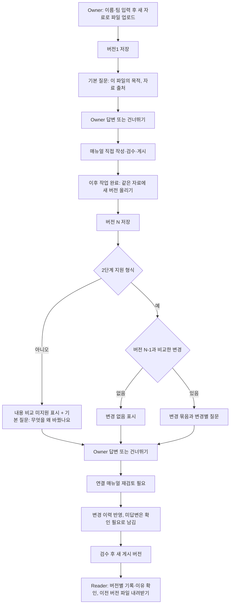

# 작업 파일 버전 기록·변경 질문 설계

작성일: 2026-10-22 (KST). 상태: **제품 방향과 두 단계 구조는 사용자 확정, 세부 설계는 제안·미구현**. 기존 웹 앱(`feat/ghostmanual-mvp`)을 확장한다.

## 1. 결정과 이유

사용자는 2026-10-22에 제품 방향을 **A. 작업 완료 파일 업로드 방식**으로 확정했다. 팀원 의견: GhostManual은 엑셀·문서 작업을 마무리할 때 업데이트하는 서비스이며, 이전 기록이 필요하면 예컨대 `데이터베이스구조_1022`를 올린 뒤 `데이터베이스구조_1021`을 불러와 보는 방식이면 된다.

검토한 대안과 판단:

| 방향 | 파일 안의 작업 확인 | 판단 |
|---|---|---|
| A. 완료 파일 업로드 + 이전 버전 비교 + 변경 질문 | 바뀐 내용을 직접 비교해 구체적으로 질문 | **채택** |
| B. Windows 앱 자동 수집 (PR #1·#2 설계) | 앱 전환·시각·승인 캡처만 자동 기록, 파일 안 작업은 기록 안 됨 | 기본 방향에서 제외. 필요가 확인되면 선택 기능 후보 |
| 클라우드 편집 기록(Google 시트 수정 기록, Excel 변경 내용 표시) | OneDrive/SharePoint·Google 파일에만 있음. 내 PC 파일은 없음 | 의존하지 않음 |

A를 고른 이유: 파일 안의 변경이 질문 거리가 되므로 질문이 구체적이고, 작업 위치(내 PC·클라우드)와 무관하며, PC 감시·설치·보안 프로그램 충돌이 없고, 기존 원본 버전·재검토·게시·공유 구조를 그대로 확장할 수 있다.

## 2. 두 단계 구조

사용자는 2026-10-22에 제품이 엑셀 전용이 아님을 확인하고 다음 두 단계 구조를 확정했다.

| 단계 | 대상 | 제공 기능 |
|---|---|---|
| **1단계: 모든 업무 파일의 버전 기록** | 허용 목록의 모든 형식 (11절) | 업로드, 버전 목록, 올린 사람·팀·시각, 이전 버전 내려받기, 기본 질문·답변, 매뉴얼 재검토 연결 |
| **2단계: 내용 비교와 구체적 질문** | 지원 형식만. 첫 지원은 `.xlsx` | 1단계 기능 + 이전 버전과 내용 비교, 변경 묶음, 변경별 질문, 미리보기 |

- 제품 설명은 "엑셀 전용"이 아니라 **"모든 업무 파일의 버전과 이유를 남기고, 엑셀부터 정밀 비교"**다.
- 2단계 지원 형식은 `.xlsx` 다음으로 Word(`.docx`), 한글(`.hwpx`·`.hwp`), PowerPoint(`.pptx`) 순서를 후보로 둔다. 실제 순서는 사용자가 많이 쓰는 형식 조사(멘토링 포함) 후 정한다. PDF는 구조가 흐트러져 비교 정확도가 낮으므로 1단계 기록만 한다.
- 형식별 비교기는 같은 인터페이스(스냅샷 추출 → 인접 버전 비교 → 변경 묶음)를 따르게 해, 새 형식을 추가할 때 1단계 기능과 질문·답변·매뉴얼 연결을 다시 만들지 않는다.

## 3. 목표

- Owner가 업무 파일을 올리고, 같은 자료에 새 버전을 계속 쌓을 수 있다 (1단계).
- 버전마다 **누가(이름), 어떤 팀이, 몇 시에** 올렸는지 확인할 수 있다 (9.1절).
- 모든 버전에 기본 질문을 붙이고 답변을 저장한다 (7.1절).
- 지원 형식(`.xlsx`)은 이전 버전과 자동 비교해 **변경 묶음**을 만들고 묶음마다 정해진 틀의 질문을 붙인다 (2단계).
- 답변을 매뉴얼 초안의 변경 이력·확인 필요 항목으로 연결한다.
- Owner와 권한 있는 Reader가 이전 버전의 기록·답변을 보고, 원본 파일을 내려받을 수 있다.
- AI 없이 동작한다.

## 4. 비목표

- 작업 과정 실시간 수집, PC·앱 감시 (B 방향).
- 이번 구현에서 `.xlsx` 외 형식의 내용 비교. Word·한글·PowerPoint 비교는 후속 2단계 확장이다.
- 매크로 포함·실행 파일·암호 걸린 파일. Google 시트·클라우드 저장소 직접 연동.
- 서식(색·글꼴·테두리)·차트·피벗 내부·매크로·주석 비교.
- 수식 재계산·실행, 업로드 파일 실행. 파일은 저장하고 읽기만 한다.
- 브라우저 안에서 원본 파일 열기(미리보기는 2단계 지원 형식의 추출 결과만).
- 파일 이름(`_1021`, `_1022`)으로 버전을 자동 추정하는 기능.
- 실제 AI 질문 생성·요약. 사용자 지시로 보류 중이며 별도 결정 후 추가한다.
- 로그인·회원 계정·팀 생성/초대·팀 단위 권한. 올린 사람과 팀은 직접 입력값으로 기록한다(9.1절). 계정 기반 식별은 후속 작업이다.

## 5. 실패로 보는 경우 (anti-goals)

- **질문 폭주:** 셀 수백 개가 바뀌었다고 질문 수백 개를 만들면 실패다.
- **추측을 사실처럼 표시:** "정렬했다", "필터 기준을 바꿨다" 같은 의도를 단정하면 실패다. 관찰한 차이와 사람이 답한 이유를 구분한다.
- **비교하지 않은 형식을 비교한 것처럼 표시:** 1단계 형식에 "변경 없음"처럼 비교 결과로 오해될 표시를 하면 실패다. "내용 비교 미지원 형식"으로 표시한다.
- **업로드하지 않은 정보 저장:** 사용자가 올린 파일 외의 정보를 모으면 실패다.
- **악성 파일 전달 통로:** 올린 파일이 다른 사람(Reader)의 브라우저에서 실행·표시되면 실패다.
- **기존 흐름 회귀:** 텍스트 자료 등록·생성·검수·공유·질문·삭제가 깨지면 실패다.
- **입력값을 확인된 신원처럼 표시:** 직접 입력한 이름·팀을 로그인으로 확인한 사용자처럼 보여 주면 실패다.

## 6. 사용자 흐름

- 처음 업로드하기 전에 올리는 사람의 이름과 팀을 한 번 입력한다. 이후 업로드에는 자동으로 붙는다 (9.1절).
- "새 버전 올리기"는 기존 자료 상세 화면에서 한다. 다른 자료와 비교하지 않는다.
- 한 자료의 버전은 같은 형식(확장자)을 유지한다. 형식이 다르면 새 자료로 올리도록 안내한다.
- 답변은 선택이다. 건너뛴 질문은 "확인 필요"로 남는다.

## 7. 질문

### 7.1 기본 질문 (1단계, 모든 형식)

| 시점 | 질문 |
|---|---|
| 버전 1 | "이 파일은 어떤 업무를 위한 것인가요?" |
| 버전 1 | "자료는 어디서 가져왔나요?" |
| 버전 2 이상, 비교 미지원 형식 | "이번 버전에서 무엇을, 왜 바꿨나요?" |
| 버전 2 이상, 지원 형식 | 기본 질문 없이 변경별 질문(8.4절). 변경이 없으면 질문 없음 |

자료 출처 질문은 파일 바깥의 흐름(ERP 다운로드, 웹 조회)을 보완한다.

### 7.2 질문 상한

- 업로드당 질문은 기본 질문 포함 **최대 10개**다.
- 2단계 우선순위(xlsx): 시트 추가·삭제 → 수식 → 자동 필터 → 이름 정의 → 행·열 수 → 값 변경.
- 상한을 넘는 묶음은 "기타 변경 N건"으로 모아 질문 하나만 붙인다.
- 숫자 10은 제안값이며 실제 사용 후 조정한다.

## 8. 2단계: `.xlsx` 내용 비교

### 8.1 스냅샷 (업로드 시 추출)

버전마다 원본 파일과 별도로 비교용 스냅샷을 만든다. 스냅샷에 담는 것:

- 시트 목록: 이름, 순서, 숨김 여부, 사용 범위(행·열 수)
- 비어 있지 않은 셀: 주소, 표시용 값(문자·숫자·날짜·불리언·오류), 수식 문자열(있을 때)
- 자동 필터: 범위와 열별 조건
- 이름 정의(defined names)

수식은 저장된 문자열만 읽고 계산하지 않는다. 캐시된 계산값이 있으면 값으로 쓴다.

### 8.2 비교 규칙

| 변경 종류 | 판정 | 묶음 단위 |
|---|---|---|
| 시트 추가·삭제 | 시트 이름 기준 | 시트 하나당 한 묶음 |
| 시트 이름 변경 | 판정하지 않음. 삭제+추가로 표시 | — |
| 수식 변경·추가·삭제 | 같은 주소의 수식 문자열 비교 | 같은 시트에서 같은 형태(행만 다른 복사 수식)는 한 묶음 |
| 값 변경 | 수식 없는 셀의 값 비교 | 시트별 한 묶음, 바뀐 범위 요약 |
| 행·열 수 변화 | 사용 범위 비교 | 시트별 한 묶음 |
| 자동 필터 변경 | 범위·조건 비교 | 시트별 한 묶음 |
| 이름 정의 변경 | 이름 기준 | 전체 한 묶음 |

- 값 변경 묶음은 "시트 '원본'에서 셀 132개 값 변경 (A2:F40 중심)"처럼 개수와 범위로 요약한다. 많은 값이 한꺼번에 움직였으면 "행 순서가 바뀌었을 수 있음"을 **관찰 메모**로 붙일 수 있으나 판정으로 표시하지 않는다.
- 비교 결과는 같은 두 버전에 대해 항상 같아야 한다(결정적).

### 8.3 미리보기

버전 상세에서 시트별 읽기 전용 미리보기(시트당 앞쪽 일부 행)를 스냅샷으로 보여 준다. 원본 파일을 브라우저에서 열지 않는다.

### 8.4 질문 틀 (AI 없음)

| 묶음 | 질문 |
|---|---|
| 시트 추가 | "시트 '{이름}'은 무엇을 위해 만들었나요?" |
| 시트 삭제 | "시트 '{이름}'을 지운 이유는 무엇인가요?" |
| 수식 변경 | "'{시트}' {범위}의 수식을 `{이전}`에서 `{이후}`로 바꾼 이유는 무엇인가요?" |
| 수식 추가 | "'{시트}' {범위}에 넣은 수식 `{수식}`은 무엇을 계산하나요?" |
| 자동 필터 | "'{시트}'의 필터 조건을 바꾼 기준은 무엇인가요?" |
| 값 변경 | "'{시트}'에서 바뀐 값 {N}개는 어떤 작업이었나요?" |
| 행·열 수 | "'{시트}'의 행·열 수가 바뀐 이유는 무엇인가요?" |
| 이름 정의 | "이름 정의를 바꾼 이유는 무엇인가요?" |
| 기타 | "나머지 변경 {N}건은 어떤 작업이었나요?" |

질문 문구의 사용자 입력 부분(시트 이름·수식)은 화면 표시 시 이스케이프하고 길이를 자른다.

## 9. 버전 열람과 매뉴얼 연결

- 자료 상세에 버전 목록을 표시한다: 버전 번호, 업로드 시각, 올린 사람·팀, 원본 파일 이름, 크기, 비교 상태(변경 N건 / 변경 없음 / 내용 비교 미지원), 답변 수.
- 버전을 고르면 그 버전의 질문·답변과, 지원 형식이면 변경 묶음·미리보기를 보여 준다.
- 원본 파일 내려받기: Owner는 모든 버전, Reader는 공유된 게시 매뉴얼이 가리키는 버전만. 현재 `sourceInTransaction`의 Reader 열람 규칙과 같다.
- 어떤 두 버전이든 골라 비교하는 기능은 이번 범위가 아니다. 인접 버전 비교만 한다.
- 기존 `updateSource`와 같이, 새 버전이 올라오면 연결 매뉴얼은 `needs_review=true`가 되어 기존 게시본은 신규 검색·답변에서 빠진다.
- 매뉴얼 초안에 **변경 이력** 정보를 둔다. 버전마다 업로드 시각, 올린 사람·팀, 변경 묶음 요약(지원 형식), 질문과 답변(작성자 설명으로 표시)이다. 이 정보는 사람이 편집하는 단계(`steps`)를 자동으로 바꾸지 않는다.
- 답하지 않은 질문은 초안의 `unknowns`(확인 필요)에 추가한다. 현재 게시 절차는 `unknowns`를 모두 확인 체크해야 게시되므로, 미답변 질문이 조용히 사라지지 않는다.
- 게시된 매뉴얼 버전은 그 시점의 변경 이력·답변을 함께 고정한다.
- AI가 꺼져 있으므로 파일 자료의 초안은 기존 "직접 작성" 흐름으로 만든다. 변경 이력과 확인 필요 항목은 시스템이 채운다.

### 9.1 올린 사람·팀·시각 기록

2026-10-22 팀원 요청: 자료를 올릴 때마다 어떤 사용자, 어떤 팀이, 몇 시에 올렸는지 확인할 수 있어야 한다. 현재 앱에는 로그인·사용자·팀이 없으므로(익명 workspace + Owner/Reader 쿠키), 사용자 결정에 따라 **직접 입력 방식(①)**으로 먼저 구현한다.

- **업로더 정보:** 작업 공간의 Owner가 이름(1~40자)과 팀(1~40자)을 입력한다. 처음 업로드 전에 반드시 입력하며, 이후 바꿀 수 있다.
- **버전에 고정:** 업로드할 때의 이름·팀을 그 버전에 함께 저장한다. 나중에 이름·팀을 바꿔도 이미 올린 버전의 기록은 바뀌지 않는다.
- **시각:** 서버가 저장 시각을 자동 기록한다. 사용자가 고칠 수 없다. 화면에는 한국 시간(KST)으로 `2026-10-22 14:05`처럼 표시한다.
- **적용 범위:** 모든 파일 버전과 텍스트 자료 버전에 적용한다. 이 기능 이전에 만들어진 버전은 "기록 없음"으로 표시한다.
- **표시:** 버전 목록과 버전 상세에 `v3 · 2026-10-22 14:05 · 박효민 (기획팀)`처럼 보여 준다. 이름 옆에 "직접 입력" 표시를 붙여 확인된 계정이 아님을 알린다. 공유된 게시 버전을 보는 Reader에게도 보여 준다. 후임자가 누구에게 물어봐야 하는지 알 수 있게 하기 위해서다.
- **개인정보:** 이름·팀은 개인정보이므로 다른 자료와 같이 workspace 7일 만료·자료 삭제 시 함께 지운다. 로그·오류 메시지에 남기지 않는다. 개인정보 안내(/privacy)에 수집 항목으로 추가한다.
- **후속(②):** 로그인·팀 기능을 만들면 이 입력값 대신 사용자 계정·팀 ID를 기록한다. 기존 입력값은 "직접 입력" 기록으로 남긴다.

## 10. 데이터와 API (제안)

현재 schema 기준으로 확장한다. 정확한 열·제약은 구현 계획과 migration에서 확정한다.

- `sources`에 자료 종류(`text` 또는 `file`)와 파일 형식(확장자)을 추가한다. 한 자료의 모든 버전은 같은 종류·형식이다.
- `source_revisions`는 그대로 버전 단위로 쓴다. 파일 버전의 `text`에는 **검색·근거용 텍스트 표현**을 둔다. 지원 형식은 추출 내용 요약(xlsx: 시트 이름·머리글 행·수식 목록), 미지원 형식은 파일 이름과 질문·답변이다. 현재 `text` 길이 제약(100~20,000자)은 파일 자료에 맞게 조정이 필요하다.
- 새 테이블 후보:
  - 원본 파일: revision별 바이트·원본 파일 이름·MIME·크기·SHA-256. 수정 금지(immutable).
  - 스냅샷: 지원 형식 revision별 비교용 JSON.
  - 변경 묶음: (revision, 이전 revision, 종류, 위치, 요약 JSON, 순서).
  - 질문·답변: (묶음 또는 기본 질문, 질문 문구, 답변 텍스트, 답변 시각, 건너뜀 여부).
- 업로더 정보: workspace 단위 현재 이름·팀과, revision마다 업로드 당시의 이름·팀(nullable, 기능 이전 버전은 null). 시각은 기존 `source_revisions.created_at`을 쓴다.
- 모든 새 테이블은 기존처럼 `workspace_id` 복합 FK와 `ON DELETE CASCADE`를 써서 자료·workspace 삭제와 7일 만료 정리에 함께 지워진다.
- 저장 위치는 PostgreSQL로 둔다. 현재 배포에는 별도 파일 볼륨이 없고, 파일 크기 상한 안에서는 DB 저장이 삭제·만료 일관성에 유리하다. 이 선택은 구현자 판단으로 바꿀 수 있으나 삭제·만료 정합성을 유지해야 한다.

| Method / Endpoint | 권한 | 내용 |
|---|---|---|
| POST /api/sources | O | 기존 multipart에 허용 형식 파일 추가, 버전 1 생성 |
| POST /api/sources/:id/revisions | O | 같은 형식의 새 버전 업로드, `expectedRevision` 필요. 지원 형식이면 비교·질문 결과 포함 |
| GET /api/sources/:id/revisions | O 또는 해당 R | 버전 목록 |
| GET /api/sources/:id/revisions/:revision | O 또는 해당 R | 질문·답변, 지원 형식이면 변경 묶음·미리보기 |
| GET /api/sources/:id/revisions/:revision/file | O 또는 해당 R | 원본 파일 내려받기 (`Content-Disposition: attachment`) |
| PATCH /api/sources/:id/revisions/:revision/answers | O | 질문별 답변 저장·건너뛰기 |
| GET·PUT /api/workspace/uploader | O | 현재 이름·팀 조회·저장. 값이 없으면 업로드 API가 422로 거부 |

- 버전 목록·상세 응답에 업로더 이름·팀·업로드 시각·비교 상태를 포함한다.
- 기존 `PATCH /api/sources/:id`(텍스트 수정)는 텍스트 자료에만 허용한다.
- 동시 업로드는 `expectedRevision` 불일치 시 409로 거부한다(기존 규칙과 같음).

## 11. 제약과 보안

- **허용 형식(제안, 1단계):** `.xlsx`·`.xls`·`.csv`·`.docx`·`.doc`·`.hwp`·`.hwpx`·`.pptx`·`.ppt`·`.pdf`·`.txt`·`.md`·`.png`·`.jpg`. 매크로 포함 형식(`.xlsm`·`.docm`·`.pptm`)·실행 파일·스크립트·압축 파일은 거부한다. 확장자와 파일 앞부분의 형식 서명이 맞지 않으면 거부한다.
- **2단계 형식 검사(xlsx):** ZIP 안의 `[Content_Types].xml`을 확인하고, 매크로 파트(`vbaProject.bin`)·암호화 파일은 거부한다.
- **크기 상한(제안):** 모든 파일 업로드 5 MiB. xlsx 비교는 압축 해제 합계 20 MiB, 시트 20개, 비어 있지 않은 셀 50,000개까지이며, 넘으면 **버전은 1단계로 저장하고 "내용 비교 한도 초과"로 표시**한다. 현재 앱 메모리 한도(384 MB)와 서버 여유를 기준으로 실제 측정 후 확정한다.
- XML 파싱은 외부 엔티티·DTD를 처리하지 않는다. ZIP 경로 조작·압축 폭탄을 막는다. 외부 링크·연결 데이터는 열지 않고 수식은 실행하지 않는다.
- 원본 파일 응답은 항상 `attachment`와 `X-Content-Type-Options: nosniff`로 내보내고 브라우저에서 열지 않는다. 화면에는 2단계 추출 결과만 표시한다.
- 파일 내용·셀 값은 사용자가 직접 올린 업무 자료이므로 저장하지만, 로그·오류 메시지·운영 기록에 남기지 않는다.
- 보관은 기존 데모 정책을 따른다: workspace 7일 만료, 자료 삭제 시 모든 버전·파일·질문·답변 삭제.
- xlsx 파싱 라이브러리는 구현 계획에서 고른다. 기준: 유지보수 중일 것, 수식 문자열·자동 필터·이름 정의를 읽을 수 있을 것, 매크로 실행이 없을 것, 알려진 취약점이 없을 것.

## 12. 인수 조건 (모두 미실행)

| ID | 확인할 결과 |
|---|---|
| F1 | 버전 1 업로드 시 기본 질문 2개가 표시되고, 답변이 재접속 후에도 남는다 |
| F2 | 같은 xlsx 자료에 버전 2를 올리면 시트 추가·수식 변경·값 변경이 각 묶음으로 나오고, 같은 입력에 같은 결과가 나온다 |
| F3 | 바뀐 셀이 수백 개여도 질문은 10개를 넘지 않고, 나머지는 "기타 변경 N건"으로 묶인다 |
| F4 | 변경이 없는 xlsx를 올리면 버전은 저장되고 "변경 없음"이 표시된다 |
| F5 | 새 버전 업로드 후 연결 매뉴얼이 재검토 필요가 되고, 미답변 질문이 확인 필요 항목에 들어가며, 모두 확인해야 게시된다 |
| F6 | Reader는 공유된 게시 버전의 기록·답변·원본 파일만 볼 수 있고, 다른 버전 요청은 거부된다 |
| F7 | 매크로 포함 형식·실행 파일·압축 파일·확장자와 내용이 다른 파일·암호 xlsx·5 MiB 초과 파일은 저장 전에 거부되고 이유가 표시된다 |
| F8 | 자료 삭제·workspace 만료 후 모든 버전·파일·질문·답변에 접근할 수 없다 |
| F9 | 기존 텍스트 자료 흐름의 단위·통합·E2E 테스트가 계속 통과한다 |
| F10 | 로그·오류 응답에 셀 값과 파일 내용이 나타나지 않는다 |
| F11 | 이름·팀 없이 업로드하면 거부되고 입력을 안내한다. 입력 후 버전마다 이름·팀·KST 시각이 "직접 입력" 표시와 함께 보인다 |
| F12 | 이름·팀을 바꾼 뒤에도 이전 버전의 기록은 업로드 당시 값으로 남는다. Reader는 공유된 게시 버전의 기록만 본다 |
| F13 | `.docx`·`.pdf` 등 비교 미지원 형식을 두 버전 올리면 둘 다 저장·내려받기되고, "내용 비교 미지원"과 기본 질문 "무엇을, 왜 바꿨나요?"가 표시된다 |
| F14 | 같은 자료에 다른 형식의 파일을 새 버전으로 올리면 거부되고 새 자료로 올리도록 안내한다 |
| F15 | xlsx가 비교 한도를 넘으면 버전은 저장되고 "내용 비교 한도 초과"로 표시된다 |

평가용 파일은 합성 데이터로 만든다. 실제 회사 자료를 요구하지 않는다.

## 13. 구현자에게 남긴 판단

- 1단계 허용 형식 목록과 크기 상한의 최종 값(측정 후)
- xlsx 파싱 라이브러리 선택과 스냅샷 JSON의 정확한 구조
- 형식별 비교기 인터페이스의 정확한 모양
- 검색·근거용 텍스트 표현을 만드는 방식과 `text` 길이 제약 조정 방법
- 시트 미리보기의 행 수, 질문 상한 10개의 최종 값
- 변경 이력을 매뉴얼 초안 JSON 안에 둘지, 버전 테이블에서 조회해 보여줄지
- 화면 배치(자료 상세 안의 버전 탭 또는 별도 화면)
- 이름·팀 입력 위치(첫 업로드 시 대화상자 또는 설정 화면)와 팀 이름을 자유 입력으로 둘지 목록에서 고를지

## 14. 다른 작업과의 관계

- PR #1·#2(Windows 자동 수집)는 이 결정으로 기본 방향이 아니다. 두 PR은 현재 웹 앱 코드를 삭제하므로 그대로 병합하지 않는다. 닫을지, 참고용으로 남길지는 팀이 정한다.
- AI(OpenAI 저가 모델 후보)는 계속 보류한다. 나중에 질문 문구 다듬기·변경 요약에 붙일 수 있도록, 질문 생성은 "변경 묶음 → 질문 문구" 함수 하나로 분리한다.
- 기존 `99`의 EXTENSIONS(PDF/Office) 중 **파일 업로드·버전 기록은 모든 형식으로, 내용 비교는 `.xlsx`만** 이 설계로 앞당긴다. Word·한글·PowerPoint 내용 비교는 후속 2단계 확장, 의미 검색·외부 연동은 여전히 후순위다.
